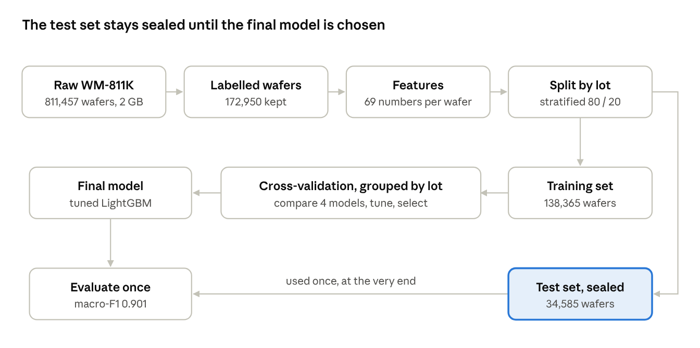
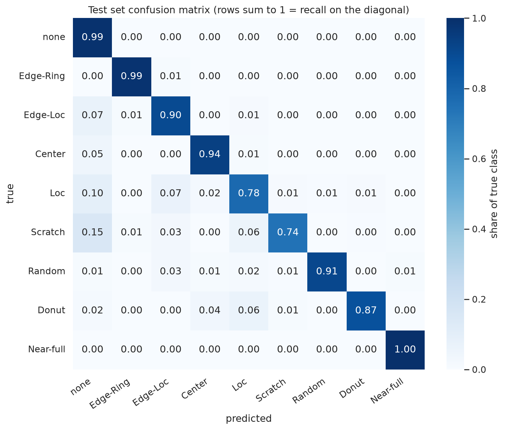

# Wafer Defect Pattern Classification (WM-811K)

A machine learning model that reads a semiconductor wafer's probe-test map and names its defect pattern, so fab
engineers can trace the faulty process step faster. Built for the SCTP Module 3 project.

**Result:** on a sealed test set of 34,585 wafers from unseen lots, the tuned LightGBM model scores
**0.901 macro-F1** and flags **95.5%** of defect wafers (baseline: 0.102 macro-F1, 0% of defects caught).



## Problem statement

- **Context:** at the end of the fab line, every die on a wafer is tested electrically at wafer probe. The
  pass/fail results laid out by position form a *wafer map*.
- **Why the pattern matters:** the spatial pattern of failed dies points to a root cause, e.g. an edge ring
  (etch/deposition), a scratch (CMP or handling), a centre blob (film non-uniformity).
- **Today:** engineers inspect maps by eye. It is slow and subjective, and at fab volumes most maps are never
  looked at.
- **The model:** classifies every map into one of 9 patterns and routes it to the right team. It acts as a
  **second line of defence after inline defect inspection**, catching problems that only show up at probe
  (e.g. CMP scratches, edge clusters, edge rings).

**ML framing:** supervised, multi-class classification (9 classes), batch prediction per lot, not a time series.

## Dataset

**WM-811K** — 811,457 wafer maps from 46,293 lots of real production, of which 172,950 (21%) are labelled.

- Source: M.-J. Wu, J.-S. R. Jang and J.-L. Chen, "Wafer Map Failure Pattern Recognition and Similarity Ranking
  for Large-Scale Data Sets", *IEEE Transactions on Semiconductor Manufacturing*, 28(1), 2015.
- Download: [WM-811K wafer map on Kaggle](https://www.kaggle.com/datasets/qingyi/wm811k-wafer-map) — the file
  `LSWMD.pkl` (~2 GB). Place it in the project root.
- Target: `failureType` — `none`, `Center`, `Donut`, `Edge-Loc`, `Edge-Ring`, `Loc`, `Near-full`, `Random`,
  `Scratch`.
- Limitations: 85% of labelled wafers are `none` (rarest class `Near-full`: 149 wafers); no timestamps; labels
  assigned by people and somewhat noisy; anonymised fab.

The data is not stored in this repo (see `.gitignore`).

## Setup

Requires [conda](https://docs.conda.io/) (Miniconda is enough).

```bash
conda env create -f environment.yml
conda activate wafer
python -m ipykernel install --sys-prefix --name wafer --display-name "Python 3 (wafer)"
```

The last line registers the environment as a Jupyter kernel; the notebooks are set to use "Python 3 (wafer)".

## Reproduce the results

Run from the project root, in order:

| Step | Command | What it does | Time* |
|---|---|---|---|
| 1 | `python src/prepare_data.py` | Loads the raw pickle, keeps the 172,950 labelled wafers → `data/labelled.pkl` | ~2 min |
| 2 | `python src/build_features.py` | 69 features per wafer + lot-grouped 80/20 train/test split → `data/features.parquet` | ~4 min |
| 3 | `notebooks/01_eda.ipynb` | Exploratory analysis: 6 findings that shaped the modelling | ~1 min |
| 4 | `notebooks/02_features.ipynb` | Explains and checks the features and the split | ~1 min |
| 5 | `notebooks/03_modelling.ipynb` | Compares 4 models, tunes LightGBM, saves `models/lgbm_tuned.joblib` | ~15 min |
| 5b | `notebooks/03b_grid_search.ipynb` | Grid search on `reg_lambda` × `num_leaves` around the final model (optional check) | ~17 min |
| 6 | `notebooks/04_evaluation.ipynb` | One-time evaluation on the sealed test set + error analysis | ~1 min |
| 7 | `notebooks/05_opportunity_sizing.ipynb` | Business value calculator with editable assumptions | seconds |

\*On a 12-core laptop with 14 GB RAM. Step 5 reuses the cached search in `reports/tuning_results.csv`; delete
that file to re-run the full hyperparameter search (~40 min).

Run notebooks interactively with `jupyter lab`, or headless with
`jupyter nbconvert --to notebook --execute --inplace --ExecutePreprocessor.kernel_name=wafer notebooks/<name>.ipynb`.

**Note on the raw file:** `LSWMD.pkl` was pickled under Python 2 with an old pandas, so `pd.read_pickle` fails.
`src/prepare_data.py` handles this with pandas' compatibility unpickler and `encoding="latin1"`.

## Approach

1. **Features (`src/features.py`):** each map, whatever its size (346 different shapes), becomes 69
   size-independent numbers — defect density overall, by ring, by edge quadrant and on a 3×3 grid; Radon-transform
   profiles (lines vs symmetric patterns); and the shape of the largest defect cluster.
2. **Leakage control:** wafers in the same lot share defect types (~90% of a lot's defects are one type), so
   train/test and every cross-validation fold are **grouped by lot** and stratified by class. The dataset's own
   `trianTestLabel` split is ignored because it is badly skewed by class.
3. **Metric:** macro-F1 (every class counts equally) plus defect recall. Accuracy is misleading: always
   predicting `none` scores 85%.
4. **Models:** majority-class baseline → logistic regression → Random Forest → LightGBM, all with class weights,
   compared on the same 5 lot-grouped folds.
5. **Tuning:** randomized search (25 configurations, 3-fold grouped CV), then the top 3 re-checked on 5 folds;
   ties broken in favour of higher defect recall. A 3×3 grid search on `reg_lambda` × `num_leaves` then
   confirmed no setting beats the final model beyond noise.

## Results

**Model comparison** (5-fold lot-grouped cross-validation, training set):

| Model | Macro-F1 | Defect recall | Defect precision | Accuracy |
|---|---|---|---|---|
| Majority class (always `none`) | 0.102 | 0.0% | — | 85.2% |
| Logistic regression | 0.756 | 98.6% | 68.8% | 92.1% |
| Random Forest | 0.868 | 88.2% | 97.5% | 97.3% |
| LightGBM | 0.894 | 96.5% | 92.5% | 97.7% |
| **LightGBM, tuned (final)** | **0.896** | **95.1%** | **94.8%** | **97.9%** |

**Test set** (used once): macro-F1 **0.901**, defect recall **95.5%**, defect precision **94.7%** — matching
cross-validation, so the estimate is honest.

- Strongest classes: Near-full (100% recall), Edge-Ring (99%), Center (94%).
- Weakest: **Scratch (74.5%)** and **Loc (78%)** — thin or small patterns lost among background defects.
- Hyperparameter with the biggest effect: L2 regularisation (`reg_lambda`); near-zero values made two runs diverge.
- At a 0.90 confidence cut-off, 97.1% of wafers are routed automatically (macro-F1 0.945) and 2.9% go to engineers.



**Opportunity sizing** (provisional, all assumptions in `05_opportunity_sizing.ipynb`): about **$2.30M a year**
net in the base case for a 50,000-wafer-a-month fab, mostly from acting sooner on problems that escape inline
inspection; the pessimistic case is still positive (~$106k a year).

**Recommendation:** deploy as a 3-month pilot of decision support — auto-route confident predictions, send the
rest to engineers — and retrain on the fab's own data first.

## Repository structure

```
.
├── README.md
├── environment.yml              # conda environment "wafer"
├── docs/
│   └── JOURNAL.md               # project journal: decisions, problems, reasoning
├── src/
│   ├── prepare_data.py          # raw LSWMD.pkl → labelled wafers
│   ├── features.py              # one wafer map → 69 features
│   └── build_features.py        # all wafers + lot-grouped train/test split
├── notebooks/
│   ├── 01_eda.ipynb
│   ├── 02_features.ipynb
│   ├── 03_modelling.ipynb
│   ├── 03b_grid_search.ipynb
│   ├── 04_evaluation.ipynb
│   └── 05_opportunity_sizing.ipynb
├── reports/
│   ├── figures/                 # charts and diagrams used in the presentation
│   ├── model_comparison.csv
│   ├── tuning_results.csv       # cached random search
│   ├── grid_search_results.csv  # cached grid search
│   ├── test_metrics.csv
│   └── opportunity_sizing.csv
├── data/                        # generated, not in git
└── models/                      # generated, not in git
```
