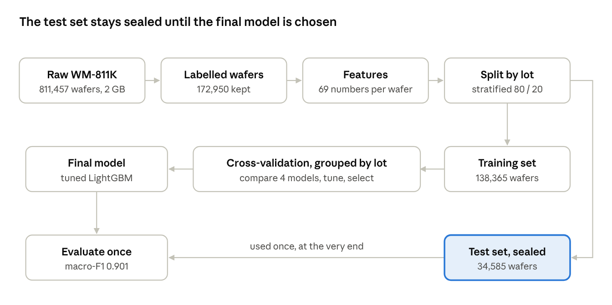
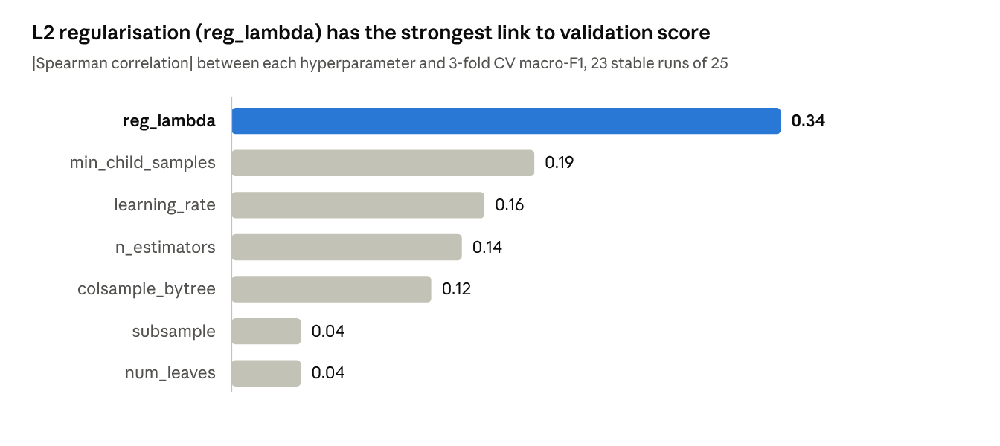
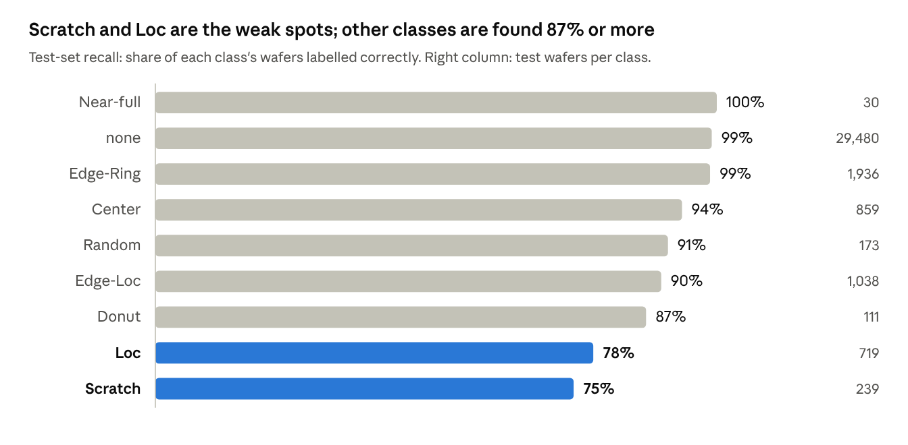
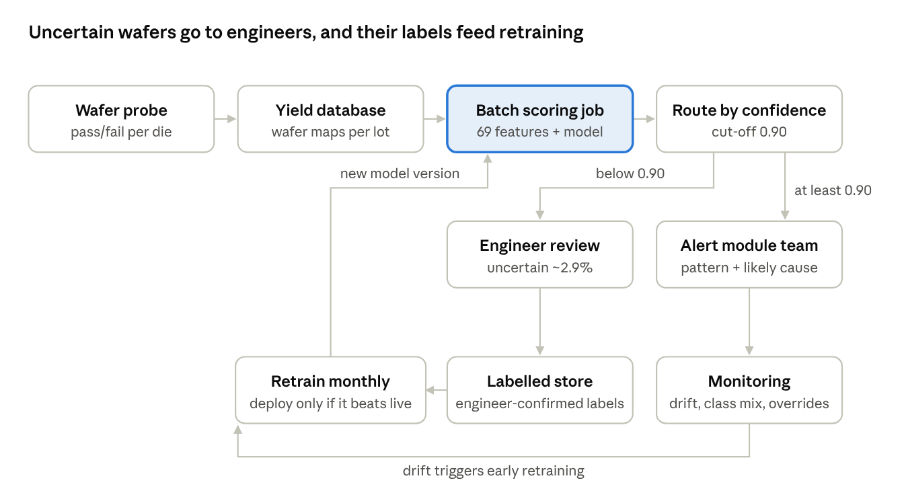
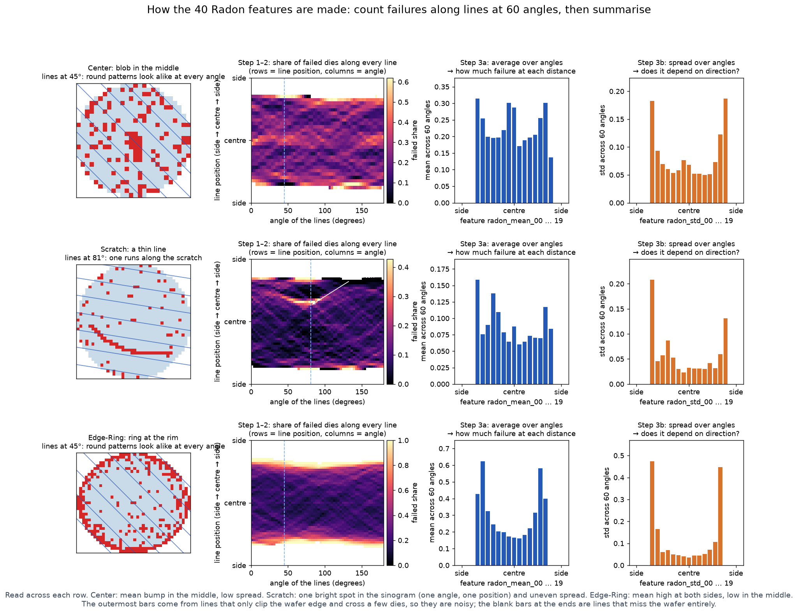

# Wafer Defect Classification — Project Journal

Oct 27, 2026 · @Eric

## Status at a glance

All 12 sections of the brief are covered. The final model scores 0.901 macro-F1 on the sealed test set and flags 95.5% of defect wafers; the base-case value is about $2.30M a year, and the recommendation is a 3-month pilot. The README and slide deck are drafted; the code is staged in git but not yet committed or pushed, pending the owner's review.

This journal records what was done, what was found, which problems came up and how they were solved, and why each method was chosen. Read it top to bottom for the full story, or jump to the Decision log and Problems sections for the reasoning.

| # | Brief section | Status | Where it lives |
| --- | --- | --- | --- |
| 1 | Problem statement | Done; rewritten for a non-semiconductor audience | Project overview; slides 1–3 |
| 2 | Type of ML problem | Done | Project overview; slide 4 |
| 3 | Dataset | Done | `src/prepare_data.py`, `01_eda.ipynb`; slide 5 |
| 4 | EDA findings | Done | `notebooks/01_eda.ipynb`; slides 6–7 |
| 5 | Feature engineering | Done | `src/features.py`, `notebooks/02_features.ipynb`; slide 8 |
| 6 | Models tried | Done | `notebooks/03_modelling.ipynb`; slide 9 |
| 7 | Hyperparameter tuning | Done: random search, then a grid search check | `03_modelling.ipynb`, `03b_grid_search.ipynb`; Q&A prep on slide 14 |
| 8 | Evaluation | Done | `notebooks/04_evaluation.ipynb`; slides 10–11, appendix A |
| 9 | Opportunity sizing | Done (numbers provisional) | `notebooks/05_opportunity_sizing.ipynb`; slide 12 |
| 10 | Deploy recommendation | Done: 3-month pilot | This journal; spoken on slide 14 |
| 11 | Deployment plan | Done: architecture, drift, A/B test | This journal; Q&A prep on slide 14 |
| 12 | GitHub + README | README written; git staged, not yet committed or pushed | `README.md`, `docs/JOURNAL.md` |

## Project overview

The project builds a model that reads a wafer's test map and names its defect pattern, so fab engineers can find the faulty process step faster.

### The assignment

SCTP Module 3: act as a data scientist, solve a real business problem with ML, and present it in 15 minutes plus 5 minutes of Q&A to a mixed technical and business audience. The brief lists 12 sections and advises focusing on 1–8. It also asks for a GitHub repo with a README.

### The business problem

- **Context:** a chip factory (fab) makes chips on round silicon wafers. At the end of the line, every die (chip) is electrically tested at wafer probe and marked pass or fail. Plotting the results gives a wafer map.
- **Why the pattern matters:** the spatial pattern of failed dies points to a root cause. A ring at the edge suggests an etch or deposition problem; a line suggests a scratch from handling or polishing; a blob in the middle suggests uneven film deposition.
- **Who is affected:** yield and process engineers, and the fab's revenue — a faulty tool keeps ruining wafers until someone notices.
- **Today (the baseline):** engineers inspect maps by eye. That is slow and subjective, and at thousands of wafers a day most are never looked at.
- **Decision the model supports:** automatically tag each wafer's pattern and route it to the right engineering team, so problems are caught earlier.

### The ML framing

| Question | Answer | Why |
| --- | --- | --- |
| Supervised or unsupervised | Supervised | Wafers carry a known label (`failureType`) to learn from |
| Classification or regression | Classification | The output is a category, not a number |
| Binary or multi-class | Multi-class, 9 classes | none, Center, Donut, Edge-Loc, Edge-Ring, Loc, Near-full, Random, Scratch |
| Batch or real-time | Batch | Wafers are scored after each lot finishes testing |
| Time series | No | Each wafer is judged on its own map; the data has no timestamps |

The model is a diagnostic tool, not a forecast: it does not predict whether dies fail (the test already says that), it reads the pattern of failures to suggest why.

Everything left of the split is fixed processing; all learning and choosing happens on the training set, and the test set is touched once at the end.

## Timeline

The work ran from 26 October to 4 November 2026; newest steps first.

| Date | Step | Outcome / files |
| --- | --- | --- |
| 4 Nov | Slide polish with the owner | "LightGBM" shown as Gradient Boosting on the models slide; drift and label-noise rows dropped from the risks slide; EDA insight 3 (skewed split) moved to Q&A prep; notes rewritten in natural spoken language; fingerprint heatmap moved to one shared 0–1 colour scale. Script 10:20 |
| 4 Nov | Dropped the tuning slide | Deck now 14 + 2 slides, script 10:35; tuning moved to the Q&A prep on the summary slide |
| 4 Nov | Brought back an error-analysis slide; shortened the closing notes | Deck now 15 + 2 slides, script 11:25; brief section 8 asks where the model fails |
| 4 Nov | Dropped the recommendation and deployment slides; added the 2.9% to the results slide | Deck now 14 + 2 slides, script 10:50; the recommendation is spoken on the summary slide and the deployment plan moved to the Q&A prep. Both remain in this journal |
| 4 Nov | Dropped the error-analysis and confidence cut-off slides; reworded the 14.9% card | Deck now 16 + 2 slides, script 12:35; key points moved into the results and deployment notes, appendix A and the Q&A prep |
| 3 Nov | Rewrote the speaker notes as a timed 15-minute script | 13:50 of speech at 106–141 words a minute, a running clock on every slide, Q&A prep on the summary slide |
| 3 Nov | Fact-checked every slide against the notebooks | All numbers matched; fixed the appendix A title (false alarms 271 outnumber misses 232), "Edge-Ring vs Edge-Loc", and "published in 2015" |
| 3 Nov | Full check: re-ran the whole pipeline from the raw file and reviewed every line of code | 21 minutes, no errors; features and test results reproduced exactly, CV scores within 0.00004. Fixed: notebook kernel, a warning that leaked a home-folder path, and the 03b rounding label |
| 3 Nov | Freely licensed wafer photos on the cover and the Chips 101 slide | Cover: T9000 wafer close-up (CC BY-SA 4.0); Chips 101: 12-inch wafer (CC BY-SA 3.0) beside a drawn wafer map; credit lines on both |
| 3 Nov | Scored the 638k unlabelled wafers, then dropped the analysis | They differed strongly from the labelled wafers (54 of 69 features shifted; confidence ≥ 0.90 on 85.6% vs 97.1%). Owner chose not to include it; its files were deleted |
| 3 Nov | Grid search check; plain-English intro slides and a wafer photo | Final model kept (+0.0033 best gain, within noise); 03b\_grid\_search.ipynb; new Chips 101 slide |
| 28 Oct | Exported this journal to the repository | docs/JOURNAL.md, with charts linked to reports/figures |
| 27 Oct | Drafted the slide deck | 17 main + 2 appendix slides with speaker notes (now 14 + 2) |
| 27 Oct | Wrote the README; initialised git and staged the files | README.md; not committed, by the owner's choice, until reviewed |
| 27 Oct | Wrote the recommendation and deployment plan | 3-month pilot; architecture diagram; drift alerts; A/B test design |
| 27 Oct | Built the opportunity-sizing calculator | Base $2.30M/yr net, pessimistic $106k; 05\_opportunity\_sizing.ipynb, reports/opportunity\_sizing.csv, tornado chart |
| 27 Oct | Reframed the business case with the owner's fab knowledge | Maps are wafer probe, not WAT or inline inspection; value comes from escapes past inline inspection |
| 27 Oct | Chose the confidence cut-off | 0.90: 97.1% auto-routed, 2.9% to engineers |
| 27 Oct | Built this journal | This doc |
| 27 Oct | Ran the test-set evaluation once | Test macro-F1 0.901, defect recall 95.5%; `04_evaluation.ipynb`, `reports/test_metrics.csv` |
| 27 Oct | Added a shortlist re-check for model selection, re-ran modelling | Final model picked with balanced class weights; `models/lgbm_tuned.joblib` |
| 27 Oct | Reviewed tuning results | Found the search's pick lowered defect recall; found 2 diverged runs |
| 27 Oct | Re-ran the modelling notebook (first run lost to shutdown) | 4-model comparison + 41-min search; `reports/model_comparison.csv`, `reports/tuning_results.csv` |
| 27 Oct | Wrote the evaluation notebook while modelling ran | `04_evaluation.ipynb` (ready to run) |
| 26 Oct | Started modelling run; laptop shut down mid-run | No results saved |
| 26 Oct | Timed each model on one fold | LR 0.75, RF 0.87, LightGBM 0.885 macro-F1 |
| 26 Oct | Built 69 features for all wafers + lot-grouped split | `src/features.py`, `src/build_features.py`, `data/features.parquet`, `02_features.ipynb` |
| 26 Oct | Explained wafer maps, the model and the feature conversion | Discussion (captured in this journal) |
| 26 Oct | EDA on labelled wafers | 6 insights + 2 data-quality notes; `01_eda.ipynb`, 6 figures |
| 26 Oct | Filtered to 172,950 labelled wafers | `src/prepare_data.py` → `data/labelled.pkl` (261 MB) |
| 26 Oct | Created the conda environment | `wafer` env, `environment.yml` |
| 26 Oct | Read the brief, identified the dataset | WM-811K (`LSWMD.pkl`, 2 GB) |

## Dataset

WM-811K holds 811,457 real wafer maps from 46,293 lots; 172,950 (21%) are labelled, and those are what we model.

- **Source:** Wu et al. (2015), *IEEE Transactions on Semiconductor Manufacturing*, published on Kaggle as the "WM-811K wafer map" dataset (`LSWMD.pkl`, 2 GB).
- **Time period:** not given — the data has no timestamps.
- **Rows and columns:** one row per wafer, 6 columns.

| Column | Meaning |
| --- | --- |
| `waferMap` | 2D grid: 0 = no die (outside the round wafer), 1 = good die, 2 = die that failed wafer probe. The main input. |
| `dieSize` | Number of dies on the wafer (we found it equals the die count exactly) |
| `lotName` | The production batch; lots hold up to 25 wafers |
| `waferIndex` | Position within the lot, 1–25 |
| `trianTestLabel` | The original authors' train/test split (typo in the original; not used) |
| `failureType` | The target: the defect pattern an engineer assigned |

### Class counts (labelled wafers)

| Class | Wafers | Share |
| --- | --- | --- |
| none | 147,431 | 85.24% |
| Edge-Ring | 9,680 | 5.60% |
| Edge-Loc | 5,189 | 3.00% |
| Center | 4,294 | 2.48% |
| Loc | 3,593 | 2.08% |
| Scratch | 1,193 | 0.69% |
| Random | 866 | 0.50% |
| Donut | 555 | 0.32% |
| Near-full | 149 | 0.09% |

### Known limitations

- **79% unlabelled** — 638k wafers cannot be used for supervised learning.
- **Severe imbalance** — the rarest class is about 1,000 times smaller than `none`.
- **No timestamps** — drift over time cannot be studied.
- **Label noise** — labels were assigned by people; some look wrong.
- **Anonymised** — fab, product and process are unknown, so root causes can only be described in general terms.

## EDA insights

Six findings shaped every later choice: the metric, the features and the way the data was split.

| # | Finding | Evidence | Decision it drove |
| --- | --- | --- | --- |
| 1 | Defects are rare | 85.2% of wafers are `none`; Near-full has 149 | Judge models on macro-F1 and per-class recall, not accuracy; use class weights; stratify splits |
| 2 | Each defect type has its own spatial signature | Example grid: Center = central blob, Edge-Ring = rim ring, Scratch = thin line | Build features that capture *where* defects are and their *shape* |
| 3 | Maps come in 346 sizes | 3 to 22,372 dies, median 776 | Use size-independent features (ratios, normalised positions) |
| 4 | Defects cluster by lot | \~90% of a lot's defective wafers share one type; 1.28 types per lot on average | Split and cross-validate by lot to avoid leakage |
| 5 | The dataset's own split is skewed | Only 12% of Edge-Ring is in its Test half vs 75% of `none` | Ignore it; build our own stratified, lot-grouped split |
| 6 | Defect density separates only some classes | Median bad-die share: Near-full 0.88, Random 0.48, but `none` 0.10 vs Scratch 0.09 | Keep density as a feature; rely on spatial features for the rest |

**Two data-quality notes**

- **Label noise:** in the example grid, one Edge-Ring wafer shows no ring and one Scratch looks random. This caps how accurate any model can be.
- **`dieSize` is the die count**, equal for 100% of rows — a wafer-size measure, not die area.

**Business reading of insight 4:** defects hitting a whole lot point to a process problem affecting a batch at once — exactly what root-cause detection is for.

**Why ML and not a simple rule (insight 6):** counting bad dies spots catastrophic wafers but cannot tell a Scratch from a normal wafer.

## Feature engineering

Each wafer map, whatever its size, becomes one row of 69 numbers that describe where its defects are and what shape they form.

**Why convert at all:** standard models (logistic regression, Random Forest, LightGBM) need the same columns for every row, but the maps come in 346 shapes. The conversion is fixed maths (counting, a Radon transform) applied the same way to every wafer — nothing in it is learned.

| Group | Count | What it measures | Classes it helps separate |
| --- | --- | --- | --- |
| Global | 2 | Wafer size (`log_n_die`) and overall defect density | Near-full, Random vs the rest |
| Rings | 4 | Defect density in 4 rings, centre to edge | Center, Donut, Edge-Ring |
| Edge quadrants | 5 | Density at top, right, bottom, left of the edge zone + asymmetry (max − min) | Edge-Ring (even) vs Edge-Loc (one-sided) |
| 3×3 grid | 9 | Density in a 3×3 grid over the wafer | Where a local blob sits (Loc, Center) |
| Radon | 40 | Mean and spread of projections across 60 angles, resampled to 20 points each | Lines (Scratch) vs symmetric patterns |
| Cluster geometry | 9 | Size, elongation, compactness and position of the largest connected defect cluster | Scratch (elongated), Center (central), Edge-Loc (at the rim) |

### Worked example: one Center wafer

Wafer 5 of `lot30`, 26×26 grid, 533 dies, 121 defective.

- **Density:** 121 / 533 = 0.227.
- **Rings:** centre 0.469, inner 0.193, outer 0.154, edge 0.253 — the centre is about twice as defective as the rest.
- **Radon:** the mean profile peaks in the middle (defects concentrated centrally); the spread across angles is low (a round blob looks the same from every direction, a line would not).
- **Largest cluster:** 19 dies, eccentricity 0.91, centre point 0.09 from the wafer centre — sitting almost exactly in the middle.

### Design choices and reasoning

- **Everything is a ratio or a normalised position** (0 = centre, 1 = rim), so a 26×26 wafer and a 200×200 wafer are comparable.
- **Radon values are divided by the projection of the wafer outline**, giving the *fraction* of defective dies along each line rather than a raw count that grows with wafer size.
- **The centre is taken from the dies' bounding box**, not the array's middle, so padding around a map does not shift it.
- **60 Radon angles, not 180:** about 3 ms per typical wafer instead of 8.5 ms; the profile shape is preserved. All 172,950 wafers took 256 seconds on 12 cores.
- **No cleaning of maps needed:** values are always 0/1/2 with no missing values; the 4 wafers with under 100 dies are valid `none` wafers and were kept.
- **The code lives in `src/features.py`**, so modelling and any future deployment use exactly the same function.

### Insight: each class has a distinct feature fingerprint

Median feature values per class confirm the features capture the patterns:

- **Center:** centre ring densest (0.68).
- **Donut:** middle ring densest (0.55).
- **Edge-Ring vs Edge-Loc:** both have a dense edge (\~0.24), but Edge-Loc is one-sided (asymmetry 0.24 vs 0.06) and its cluster sits at the rim (0.88), while Edge-Ring's cluster *is* the ring, so its centre point lands at the wafer centre (0.06).
- **Scratch:** the most elongated cluster (eccentricity 0.98).
- **Near-full:** about 0.9 on everything.
- **none, Loc and Scratch** look most alike — predicted to be the hardest to separate, which the evaluation later confirmed.

## Train/test split and leakage controls

20% of lots were set aside as a sealed test set with zero lot overlap, and every class sits exactly 80/20.

|  | Train | Test |
| --- | --- | --- |
| Wafers | 138,365 | 34,585 |
| Lots | 8,601 | 2,161 |
| Lots in both | 0 | 0 |
| Near-full (rarest class) | 119 | 30 |

**Method:** `StratifiedGroupKFold(n_splits=5)` with `groups = lotName`; one fold became the test set. *Grouped* keeps whole lots together; *stratified* keeps each class's share the same in both halves.

**Why group by lot:** wafers in a lot went through the same tools and usually share a defect type (EDA insight 4). A random split would put near-duplicates in both train and test, so the model would effectively see the answers and scores would look better than reality.

### Leakage controls

1. **Lot-grouped split** for the test set, and lot-grouped cross-validation inside the training set during tuning.
2. **Per-wafer features only** — each feature uses that wafer's own map, never statistics from other wafers.
3. **Scaling inside a Pipeline** — the `StandardScaler` for logistic regression is re-fit on each training fold only.
4. **Class weighting on training data only** — the test set keeps the real-world class mix.
5. **Dropped columns** — `trianTestLabel` (unreliable), `waferIndex` (position in the lot, not a physical property); `dieSize` is already captured by `log_n_die`.
6. **Test set used once**, at the very end, after the model was chosen.

## Models tried

LightGBM won, reaching about 0.90 macro-F1 against 0.10 for the always-"none" baseline; each step up in complexity paid off.

### Why macro-F1 is the main metric

- **F1** balances precision (of the wafers called class X, how many really are X) and recall (of the real X wafers, how many were found).
- **Macro** averages F1 over the 9 classes equally, so a rare class like Near-full counts as much as `none`.
- **Accuracy misleads:** always predicting `none` scores 85% accuracy while catching zero defects.
- **Defect recall** is the business view: of the wafers that really have a defect, what share gets flagged as *some* defect. A missed defect means a faulty tool keeps running.

### Results (5-fold lot-grouped cross-validation, training set only)

| Model | Macro-F1 | Defect recall | Defect precision | Accuracy | Weakest class (recall) |
| --- | --- | --- | --- | --- | --- |
| Baseline: always `none` | 0.102 | 0% | — | 85.2% | every defect class (0) |
| Logistic regression | 0.756 | 98.6% | 68.8% | 92.1% | Loc (0.75) |
| Random Forest | 0.868 | 88.2% | 97.5% | 97.3% | Scratch (0.56) |
| LightGBM | 0.894 | 96.5% | 92.5% | 97.7% | Scratch (0.78) |
| LightGBM, tuned (final) | 0.896 | 95.1% | 94.8% | 97.9% | Scratch (0.75) |

### Why these models

- **Baseline (majority class):** shows what you get with no model, and why accuracy is the wrong yardstick.
- **Logistic regression:** the simplest real model — a weighted sum of features per class. It flags nearly every defect but raises many false alarms (precision 69%) because it can only draw straight boundaries.
- **Random Forest:** 300 decision trees that vote. Captures nonlinear patterns; very precise (97.5%) but misses more defects (88%).
- **LightGBM (gradient boosting):** trees built one after another, each fixing the previous ones' errors. Usually the strongest on tables of numeric features, and it was here.
- **All models used class weights** (except the baseline), so mistakes on rare classes cost more during training.
- **Same 5 folds for every model**, so the comparison is fair. Scores are *out-of-fold*: each wafer is predicted by a model that never saw its lot.

**Not built: a CNN on the raw images.** It was listed as an optional extra. Given the tight timeline and LightGBM's strong result on interpretable features, it was left out; it is a fair answer to "what would you try next?" in Q&A.

## Hyperparameter tuning and model selection

Tuning added only about 0.005 macro-F1; its real lessons were that L2 regularisation matters most and that class weighting controls the defect-recall trade-off.

### Setup

- **Method:** `RandomizedSearchCV`, 25 random LightGBM configurations, scored by macro-F1 with 3-fold lot-grouped CV on the training set. It took 40.8 minutes.
- **Why random, not grid search:** with 8 hyperparameters a full grid needs thousands of fits; random search covers the space well with far fewer.
- **Searched:** `n_estimators` (200–800), `learning_rate` (0.02–0.2), `num_leaves` (15–128), `min_child_samples` (5–100), `subsample` (0.6–1.0), `colsample_bytree` (0.4–1.0), `reg_lambda` (0.001–10), and `class_weight` (none or balanced).
- **Cached:** results are saved in `reports/tuning_results.csv`, so re-running the notebook skips the 40-minute search.

### Findings

- **`reg_lambda` (L2 regularisation) mattered most.** Two configurations diverged (macro-F1 0.69 and 0.22); both had near-zero regularisation (\~0.001) and no class weights. Even with those two removed, `reg_lambda` had the strongest link to the score (|Spearman| 0.34).
- **Why:** each boosting round adds 9 trees, one per class. For rare classes with few examples, leaf values can become extreme; without regularisation, and with a higher learning rate, those values compound until training collapses.
- **The landscape is flat:** the 23 stable runs scored 0.870–0.895, and the top 4 are within one standard deviation (±0.007) of each other.
- **`class_weight` barely moves macro-F1** (0.887 balanced vs 0.883 none, stable runs) but shifts precision vs recall.
- **Every configuration scores \~1.00 on its training folds** (gap \~0.10): trees memorise training wafers, so only validation scores are trustworthy.

No other hyperparameter comes close; `num_leaves` and `subsample` barely matter in the ranges searched.

### The model-selection problem and its fix

The search's top pick turned class weighting off and caught fewer defects than the untuned model. Because the top configurations were statistically tied, the top 3 were re-checked on all 5 folds with a rule fixed before looking at the test set: **highest macro-F1; within 0.005, prefer higher defect recall.**

| Search rank | Class weight | 5-fold macro-F1 | Defect recall | Defect precision |
| --- | --- | --- | --- | --- |
| 0 (search's pick) | none | 0.897 | 92.9% | 97.2% |
| 1 | balanced | 0.899 | 94.9% | 95.3% |
| 2 (selected) | balanced | 0.896 | 95.1% | 94.8% |

All three are within 0.005, so rank 2 won on defect recall. Final settings: 676 trees, learning rate 0.066, 77 leaves, `min_child_samples` 8, subsample 0.78, `colsample_bytree` 0.59, `reg_lambda` 2.34, balanced class weights.

### Grid search check

A 3×3 grid search on the two most important hyperparameters confirmed the final model: no setting beat it by more than noise.

- **Setup:** `reg_lambda` (0.5, 2.34, 8) × `num_leaves` (31, 77, 127), other settings fixed at the final model's values; 3-fold lot-grouped CV on the training set; 16.8 minutes (`notebooks/03b_grid_search.ipynb`).
- **Rule set before running:** switch only if a setting beats the final model by more than the ±0.007 fold-to-fold spread.
- **Result:** the best setting (`reg_lambda` 0.5, 77 leaves) was +0.0033 macro-F1, inside the spread, so the final model stays. All 9 settings fall within 0.0066 (0.8896–0.8962). The grid used `reg_lambda` rounded to 2.34, which is why the final setting scores 0.8929 there versus 0.8943 in the random search with the exact 2.3396.
- **Trade-off revealed:** stronger regularisation and simpler trees (`reg_lambda` 8, 31 leaves) catch the most defects (96.0% defect recall) at the lowest macro-F1 (0.8896) — the same precision-vs-recall lever as class weighting.
- **Why both methods:** random search explores many hyperparameters cheaply; grid search then checks the most important ones exhaustively.

### Feature importance (final model)

Cluster geometry carries about half of the model's decisions (0.51 of total gain), then Radon (0.21), rings (0.15), global (0.06), grid (0.04) and edge quadrants (0.04).

## Final evaluation on the test set

On 34,585 unseen wafers the model scored 0.901 macro-F1 and flagged 95.5% of defect wafers, matching cross-validation — so the estimate was honest.

| Metric | Validation (5-fold CV) | Test | Baseline on test |
| --- | --- | --- | --- |
| Macro-F1 | 0.896 | 0.901 | 0.102 |
| Weighted F1 | 0.979 | 0.980 | 0.784 |
| Accuracy | 97.9% | 98.0% | 85.2% |
| Defect recall | 95.1% | 95.5% | 0% |
| Defect precision | 94.8% | 94.7% | — |

### Business view

- **Caught:** 4,873 of 5,105 defect wafers flagged; 232 missed.
- **False alarms:** 271 normal wafers flagged.
- **Flagged:** the model flags 5,144 of 34,585 wafers (14.9%) as a defect, close to the true 14.8%; the other 85% need no action. This is not the same as the 2.9% below the 0.90 cut-off, which go to an engineer for review.
- **Right diagnosis:** when a real defect is flagged, the defect type is correct 96.0% of the time.

### Where it fails

- **Weakest classes: Scratch (0.74 recall) and Loc (0.78).** Most misses are predicted as `none` (15% of Scratch, 10% of Loc). Thin scratches and small blobs involve few dies and get lost among random background defects.
- **Most common confusions:** `none` → Edge-Loc (105 wafers), `none` → Loc (95), Edge-Loc → `none` (75), Loc → `none` (69), Loc → Edge-Loc (50).
- **The mistakes look borderline:** the misclassified wafers are mostly faint, sparse patterns that are hard to call even by eye, and some look mislabelled. Part of the error is a label-quality ceiling, not only a model limit.
- **By wafer size:** best on very large wafers (macro-F1 0.93, defect recall 97.9%), weakest on medium ones (0.85, 91.8%) — fewer dies means a pattern is made of fewer pixels.

### Confidence threshold — the basis for human-in-the-loop

The model gives a confidence (its top class probability) for each wafer. Routing automatically only when confidence is at least 0.90 covers 97.1% of wafers at 0.945 macro-F1; the other 993 wafers (2.9%) go to an engineer. Raising the threshold to 0.95 lifts macro-F1 to 0.956 but sends 1,370 wafers (4.0%) to people. **Chosen: 0.90.** Note the scores are not calibrated probabilities (class weighting shifts them), so the cut-off is justified by the measured accuracy above, not by the number itself.

## Opportunity sizing

The base case is worth about $2.30M a year after running costs, and even the pessimistic case pays back its build cost in about 14 months.

### Where the model adds value

The maps come from wafer probe at the end of the line. Most tool problems are caught earlier by inline defect inspection, which stops the tool, so the model is a second line of defence:

- **Escapes:** problems inline inspection misses that first show up at probe. The owner's experience: CMP scratches, edge clusters and edge rings, conservatively 2–3 a month. The model shortens the lag from probe result to action.
- **Review time:** engineers review a sample of maps by hand today; the model reads every map and sends only the uncertain 2.9% to people.
- **Not claimed:** the model cannot shorten the weeks between the faulty process step and probe.

### Results (USD)

|  | Pessimistic | Base | Optimistic |
| --- | --- | --- | --- |
| Review time saved / year | $19k | $160k | $514k |
| Escape losses avoided / year | $126k | $2.17M | $16.4M |
| Net value / year, after running cost | $106k | $2.30M | $16.9M |
| Payback of build cost | \~14 months | under 2 weeks | days |
| Wafers saved / year | \~126 | \~1,740 | \~10,900 |

### Key assumptions (base case)

| Input | Base value | Source |
| --- | --- | --- |
| Wafers per month | 50,000 | Owner (UMC 12i-scale fab) |
| Escapes per month | 2.5 (range 2–3) | Owner, conservative |
| Hours to act on a probe map today | 12 (range 8–24) | Owner |
| Hours to act with the model | 1 | Claude |
| Wafers per hour on the affected tool | 20 | Claude (the whole fab moves \~69 an hour, so the owner's 500 was revised) |
| Share of wafers lost during an escape | 30% | Claude |
| Wafer cost | $1,250 (range $1,000–1,500) | Owner |
| Engineer cost | $45/hour fully loaded | Claude (owner: $30 base salary) |
| Share of maps reviewed by hand today | 10% | Claude |
| Build cost / yearly running cost | $75k / $30k | Claude |
| Recall on escape types | 0.878 | Test set: average of Scratch 0.745, Edge-Loc 0.901, Edge-Ring 0.988 |

### What the numbers say

- **Escapes drive about 93% of the value**; review time saved is the smaller part.
- **Biggest uncertainties:** hours to act today, share of wafers lost, and wafers per hour on the tool. A pilot should measure these from fab excursion records.
- **Break-even is low:** in the pessimistic case, 0.33 escapes a month covers the running cost.
- **Scratch recall (74.5%) is the most valuable model upgrade**, since CMP scratches are a common escape.

### How the estimate evolved

1. First pass counted every tool problem (1–3 a month) as something the model catches: base $2.05M.
2. The owner pointed out that inline inspection catches most problems and stops the tool, so only probe-level escapes count. With a guessed 0.5 escapes a month the base fell to $0.63M, and the pessimistic case lost money.
3. The owner then gave the real escape rate (2–3 a month) and types; using the model's recall on those types gives the final $2.30M base.

## Recommendation: deploy as a pilot

Deploy, starting as a 3-month pilot of decision support: the model routes wafer maps it is at least 90% confident about and sends the rest to engineers; inline inspection and existing alarms stay unchanged.

### Why deploy

- **Performance holds on unseen lots:** test macro-F1 0.901 (validation 0.896), 95.5% of defect wafers flagged, the right defect type 96% of the time.
- **The value is large and robust:** base case $2.30M a year net; even the pessimistic case is positive ($106k) and breaks even at 0.33 escapes a month, against the owner's conservative 2–3.
- **The risk is low:** it adds a check after probe and changes no existing control; uncertain wafers (2.9%) still go to people.

### Why a pilot first, not a full rollout

- The value rests on estimates (hours to act, wafers lost per escape) that the fab should measure first.
- The model was trained on another fab's data, published in 2015; it must be retrained and checked on this fab's own wafer maps.

### Risks and limitations

| Risk | Effect | Mitigation |
| --- | --- | --- |
| Scratch recall only 74.5%, Loc 78% | About 1 in 4 scratches missed — and CMP scratches are a common escape | Keep manual review for CMP-heavy products during the pilot; make Scratch the first model upgrade |
| Different fab, products and era | Accuracy may drop on this fab's maps | Retrain on the fab's labelled maps before the pilot; compare against this baseline |
| New defect patterns outside the 9 classes | The model forces them into a known class | Low-confidence wafers go to engineers; track the share of low-confidence wafers |
| Drift (new products, die sizes, tools, process changes) | Accuracy decays silently | Drift monitoring and scheduled retraining (see Deployment plan) |
| Label noise | Caps accuracy; errors look like real misses | Engineer-confirmed labels from the review queue improve the training data |
| Confidence scores are not calibrated | 0.90 is not a true 90% probability | The cut-off is justified by measured accuracy; re-check it in the pilot |
| Engineers over-trust the model | Missed escapes go unchallenged | Audit a random sample of auto-routed wafers each week |

**Regulatory:** low — internal manufacturing data with no personal information. Wafer maps are confidential process IP, so the model runs inside the fab network.

**Pilot success criteria (proposed):** hours to act on a probe map fall by at least half; missed escapes no higher than with manual review; engineer override rate under 10%.

## Deployment plan

The model runs as a batch job after each lot's wafer probe, routes confident results automatically, and learns from the wafers engineers review.

Wafers the model calls `none` with confidence of at least 0.90 are simply archived; only defect patterns raise an alert.

### Retraining

- **Monthly**, on the latest labelled data, which grows with every engineer-reviewed wafer.
- **Early**, when monitoring flags drift.
- **Validation gate:** a new model goes live only if it beats the live model on recent held-out lots (macro-F1 and Scratch recall). The live model is kept for instant rollback.

### Drift detection

| Signal | What it catches | Alert when (proposed) |
| --- | --- | --- |
| Feature distributions (density, ring and edge features) vs training data | New products, die sizes or process shifts | Population stability index above 0.2 |
| Predicted class mix | A pattern appearing far more or less often | Any class share doubles or halves week on week |
| Share of low-confidence wafers | Patterns the model hasn't seen | Above twice the 2.9% baseline |
| Engineer override rate | The model being wrong in practice | Above 10% of reviewed wafers |

### A/B test before full rollout

- **Units:** lots, randomly split 50/50 at probe, for 8–12 weeks.
- **Control:** the current process — engineers review maps as today.
- **Treatment:** model routing, with engineers reviewing only the uncertain wafers.
- **Primary metric:** hours from probe map ready to action, for lots with a confirmed defect pattern.
- **Guardrails:** missed escapes (from a weekly audit sample), false alarms, and engineer workload.
- **Roll out** if hours to act fall by at least half and missed escapes are no higher than in control.
- **Roll back** if missed escapes rise above control or the override rate stays above 10%.
- **Caveat:** one tool problem can hit lots in both groups, so detection time is compared per lot, not per incident.

## Deliverables: slide deck and repository

The slide deck (14 slides plus 2 appendix) and the GitHub-ready repository are drafted; nothing has been committed or pushed yet.

### Slide deck

[Wafer Defect Classification deck](https://claude.ai/artifact/PzdeiiKULNYJC3xCxBt7Wy) — private until shared from its Share menu; exports to PowerPoint or PDF.

| Part | Slides |
| --- | --- |
| Problem | 1 Cover · 2 Chips 101 · 3 Business problem · 4 ML framing |
| Data and EDA | 5 Dataset · 6 Imbalance · 7 Lot clustering and split · 8 Features |
| Modelling | 9 Models compared · 10 Test results · 11 Error analysis |
| Business | 12 Opportunity sizing · 13 Risks · 14 Summary and questions |
| Appendix | A Confusion matrix · B Leakage controls |

- **Speaker notes** on every slide, with timings adding up to about 10:20, leaving about 4½ minutes spare.
- **Audience:** the opening slides were rewritten for people outside semiconductors — a Chips 101 slide, a baking-tray analogy, and no die, probe or CMP jargon.
- **Images:** cover — Inmos T9000 wafer close-up (JPJI, CC BY-SA 4.0, cropped) under a navy overlay; Chips 101 — a 12-inch wafer (Peellden, CC BY-SA 3.0, resized) beside a drawn wafer-map illustration. Each photo carries its credit line, as the licences require.
- **Left to fill:** `[GitHub link]` on the last slide.

### Repository

- **README.md** covers brief section 12: overview and problem, dataset and how to download it, setup, step-by-step reproduction, results, repository structure.
- **Git:** initialised on branch `main`, files staged, no commit yet — the owner reviews first. Pushing needs a GitHub repo URL.
- **Kept out of git:** the raw and generated data (`*.pkl`, `*.zip`, `data/`), the trained model (`models/`, regenerated by notebook 03) and the course brief PDF.
- **docs/JOURNAL.md:** a Markdown export of this journal; re-export after any change here.
- **Notebook kernel:** run the notebooks with “Python 3 (wafer)”.

## Problems encountered and how they were solved

Fifteen problems came up; none blocked the project, and each fix is now built into the code or the workflow.

| Problem | Cause | Solution |
| --- | --- | --- |
| `pd.read_pickle` failed: `No module named 'pandas.indexes'` | The pickle was saved in 2019 by an old pandas whose module paths no longer exist | Alias the old path: `sys.modules['pandas.indexes'] = pandas.core.indexes` |
| Then `UnicodeDecodeError: 'ascii' codec can't decode` | The file was pickled under Python 2 | Load with pandas' compatibility unpickler and `encoding='latin1'` (in `src/prepare_data.py`) |
| Loading 2 GB every time is slow and memory-hungry (14 GB laptop) | Raw file holds 811k wafers, 79% unlabelled | Filter once to labelled wafers and save `data/labelled.pkl` (261 MB) |
| Labels stored as nested arrays like `[['Center']]`, empty for unlabelled | Original data format | `unwrap()` helper extracts the string or `None` |
| Feature heatmap labels were garbled long decimals | float32 values printed without a number format | Cast to float and format to 2 decimals |
| Modelling run lost when the laptop shut down | Results are only written when the whole notebook finishes | Re-ran next session; added a cache for the 40-minute search so re-runs take \~15 min |
| `conda` not found the next day | Shell switched to zsh without conda on its PATH | Call conda by full path: `/home/eric/miniconda3/bin/conda` |
| Notebook generator scripts disappeared | They lived in a temporary folder cleared on reboot | Edited the notebooks directly; the notebooks are the source of truth |
| Tuning picked a model that missed more defects | Search optimised macro-F1 only, and top configs were tied | Shortlist re-check on 5 folds with a recall tie-break (see Hyperparameter tuning) |
| Two tuning runs collapsed (0.69, 0.22) | Near-zero L2 regularisation made rare-class trees unstable | Reported as a finding; analysed effects with and without them |
| Jupyter's default python3 kernel would not start | A kernel entry left by another project pointed to a deleted temporary Python | Registered a project kernel inside the conda environment (python -m ipykernel install --sys-prefix --name wafer); global settings left untouched |
| A notebook warning printed the owner's home-folder path | scikit-learn warns when scoring the always-"none" baseline, which predicts no defects | Removed the output before staging, then silenced that specific warning in the notebook code |
| A word vanished from a notebook summary | The shell treated text in backticks as a command | Re-applied the edit with a Python script instead of a shell string |
| Charts became text placeholders in the Markdown export | Live charts in the online journal cannot be exported as Markdown | Replaced each placeholder with the matching image in reports/figures |
| Risk of overwriting the owner's own slide edits | The deck is edited both in the browser and by Claude | Read the latest version of a slide before every change |

## Decision log

Every major choice, the alternatives considered, and why the choice won.

| Decision | Alternatives considered | Reasoning |
| --- | --- | --- |
| Use WM-811K, not the suggested HDB resale data | HDB price regression | A real industrial problem with clear business value and a richer story (imbalance, leakage, spatial features) |
| Model only the 173k labelled wafers | Semi-supervised use of the 638k unlabelled | Supervised learning needs labels; unlabelled data is a possible extension |
| Macro-F1 as the main metric | Accuracy, weighted F1 | Accuracy rewards ignoring defects (85% for always `none`); macro-F1 weights every class equally |
| Defect recall as the business tie-break | Defect precision | A missed defect lets a faulty tool keep running, which costs more than an engineer checking a false alarm |
| Hand-crafted features + tree models | CNN on raw images | Interpretable, fast on a laptop, strong results; a CNN is an optional extra |
| Ratios and normalised positions as features | Raw counts, resized images | Makes wafers of 346 sizes comparable |
| Lot-grouped, stratified split, own 80/20 | Random split; dataset's own `trianTestLabel` | Random leaks near-duplicate wafers; the given split is badly skewed by class |
| Class weights in training | Downsampling `none`; oversampling (SMOTE) | Uses all data, no synthetic wafers, simple; test set keeps the real mix |
| Random search, 25 configs, 3-fold | Grid search; 5-fold search | 8 hyperparameters make a grid impractical; 3 folds kept runtime at \~40 min |
| Re-check the top 3 on 5 folds before choosing | Take the search's top pick | The top configs were statistically tied; the re-check found one that catches more defects |
| Test set used once, after choosing the model | Peeking during tuning | Peeking makes the test score optimistic and no longer independent |
| Feature code in `src/`, not only in notebooks | Notebook-only code | The same function can serve modelling and a future deployment |
| Recommend human-in-the-loop routing at 0.90 confidence | Fully automatic routing; a stricter 0.95 cut-off | 97% of wafers can be auto-routed at high confidence; the uncertain 2.9% (993 test wafers) go to engineers. A 0.95 cut-off adds about 1 point of macro-F1 but 38% more manual reviews. There is no industry-standard cut-off, so it is a cost trade-off to revisit once real costs are known |
| Value the model as a second line of defence after inline inspection | Count every tool problem as one the model catches | Inline inspection catches most problems and stops the tool; only escapes first seen at probe (CMP scratches, edge clusters, edge rings) are the model's to catch |
| Use recall on the escape classes (0.878) in the value estimate | Overall defect recall (95.5%) | Escapes are mostly Scratch, Edge-Loc and Edge-Ring, and Scratch recall is only 74.5%; the overall figure would overstate the value |
| 20 wafers per hour on an affected tool | 500 per hour (first estimate) | A 50k-wafer-a-month fab moves about 69 wafers an hour in total, so one tool sees far fewer |
| Pessimistic, base and optimistic cases plus a one-at-a-time sensitivity check | A single point estimate | The inputs are guesses; showing the range and which input drives it makes the estimate defensible |
| Add a 3×3 grid search after the random search | Random search only; a CNN instead | Shows both tuning methods and checks the two most important hyperparameters exhaustively for 17 minutes of compute |
| Drop the unlabelled-wafer analysis | Keep it as a drift slide; hand-label a sample | Owner's call, to keep the project focused; it cannot measure accuracy without labels |
| Rewrite the opening slides for a non-semiconductor audience | Keep industry terms | The audience is mixed; a Chips 101 slide and an everyday analogy make the problem clear in under a minute |
| Use freely licensed photos with credit lines | Photos of a real company product | Company wafer photos can be confidential; Creative Commons photos are free to use when credited |
| Keep the opportunity-sizing numbers provisional | Finalise them now | Several inputs are estimates; review before the slides are final |
| Stage in git but do not commit or push yet | Commit and push straight away | The owner wants to review and understand everything first |
| A project-local Jupyter kernel | Repair the global python3 kernel | Fixes this project without changing settings other projects use |
| Drop the error-analysis and confidence cut-off slides | Keep both slides | Owner's call, to shorten the talk. Weak spots stay in the results notes and appendix A; the cut-off stays in the deployment notes and the Q&A prep |
| Drop the recommendation and deployment-plan slides | Keep both slides | Owner's call: the brief advises focusing on sections 1–8. The deploy decision is still spoken on the summary slide; the deployment plan is in the Q&A prep and this journal |
| Bring back one error-analysis slide | Leave it in the notes and appendix A only | Brief section 8 asks where the model fails, and sections 1–8 are the priority; there was time to spare |
| Drop the tuning slide | Keep it | Owner's call. Tuning stays in notebooks 03 and 03b, this journal and the Q&A prep; the models slide still shows the tuned result |

## Glossary

Plain-language meanings of the terms used in this project, in alphabetical order.

| Term | Meaning |
| --- | --- |
| Batch prediction | Scoring many items together on a schedule (here, after each lot is tested) rather than one at a time in real time |
| Class weight | Makes mistakes on rare classes cost more during training, so the model doesn't ignore them |
| CMP | Chemical-mechanical polishing: a step that polishes the wafer flat, and a common source of scratches |
| Confidence | The model's probability for its chosen class; 0.95 means it is fairly sure |
| Confusion matrix | A grid of true class vs predicted class; the diagonal is what it got right |
| Cross-validation (CV) | Split the training data into k folds; train on k−1, test on the one left out, repeat k times |
| Data leakage | Information from the test set sneaking into training, making scores look better than reality |
| Defect recall / precision | Recall: share of real defect wafers that get flagged. Precision: share of flagged wafers that really have a defect |
| Die | One chip on a wafer |
| Eccentricity | How stretched a shape is: 0 = circle, near 1 = a line |
| Escape | A process problem that inline inspection misses and that first shows up at wafer probe |
| F1 score | A balance of precision and recall for one class |
| Fab | A semiconductor factory |
| Gradient boosting (LightGBM) | Trees built one after another, each correcting the previous trees' errors |
| Grid search | Tuning by trying every combination of a few chosen hyperparameter values |
| Grouped split | Keeping all wafers from one lot on the same side of a split |
| Hyperparameter | A setting chosen before training (e.g. number of trees), not learned from data |
| Inline inspection | Checks during manufacturing that look for physical defects and stop a faulty tool |
| L2 regularisation (`reg_lambda`) | A penalty that stops the model's values from growing extreme; keeps training stable |
| Lot | A batch of up to 25 wafers processed together |
| Macro-F1 | F1 averaged over all classes equally, so rare classes count as much as common ones |
| Out-of-fold prediction | A prediction for a wafer from a CV model that never saw that wafer's lot |
| PSI (population stability index) | How much a feature's distribution has shifted between two datasets; above 0.2 signals drift |
| Radon transform | Sums defects along lines at many angles; reveals lines (scratches) and symmetric shapes |
| Random Forest | Many decision trees trained on random samples of the data that vote on the answer |
| Random search | Tuning by trying random combinations from given ranges; covers many hyperparameters cheaply |
| Stratified split | Keeping each class's share the same on both sides of a split |
| Wafer | A thin silicon disc that carries hundreds to thousands of chips |
| Wafer map | The pass/fail result of every die, laid out in its position on the wafer |
| Wafer probe | The end-of-line electrical test of every die; its results form the wafer map |
| WAT (wafer acceptance test) | Electrical tests on small test structures between dies; measures process parameters, not each chip |

## Revision Q&A

The owner's questions while reviewing the project on 3 November 2026, with condensed answers for revision and Q&A practice.

### 1. How is each feature calculated?

Every wafer becomes 69 numbers (2 + 4 + 5 + 9 + 40 + 9), computed by `src/features.py`. Example values are for wafer 5 of `lot30` (Center, 533 dies, 121 failed).

- **Set-up:** masks `on` (a die is there) and `bad` (the die failed). Positions are rescaled to −1…+1 from the dies' bounding box: `y = (row − centre_row) / half_height`, `x = (col − centre_col) / half_width`, `dist = √(y² + x²)` (0 = centre, ≈1 = rim). Most features are a rate: failed dies in a region ÷ dies in that region.
- **Global (2):** `log_n_die` = ln(dies) = 6.28; `density` = failed ÷ dies = 121/533 = 0.227.
- **Rings (4):** failure rate for dist 0–0.25, 0.25–0.5, 0.5–0.75, ≥0.75 → 0.469, 0.193, 0.154, 0.253 (centre twice as bad: the Center signature).
- **Edge quadrants (5):** edge zone (dist ≥ 0.75) cut into top, right, bottom, left slices of 90° using `angle = atan2(−y, x)`; rate per slice (0.281, 0.250, 0.262, 0.219) and `edge_asymmetry` = max − min = 0.062. Edge-Ring is even (≈0.06); Edge-Loc is one-sided (≈0.24).
- **3×3 grid (9):** square cut at ±⅓ on both axes; rate per cell (middle cell 0.281). Shows where a local blob sits.
- **Radon (40):** failures summed along parallel lines at 60 angles; divided by the same sum over all dies, giving the failed share per line; then the mean across angles (`radon_mean_00…19`) and the standard deviation across angles (`radon_std_00…19`), each resampled to 20 points.
- **Cluster geometry (9):** touching failed dies (including diagonals) grouped into clusters; the largest one measured: clusters per die (0.077), area ÷ dies (0.036), area ÷ failed dies (0.157), perimeter ÷ √dies (0.687), long axis ÷ wafer diameter (0.314), eccentricity √(1 − b²/a²) (0.91), solidity = area ÷ convex-hull area (0.826), extent = area ÷ bounding-box area (0.679), and centre-point distance from the wafer centre (0.096). For Edge-Ring the largest cluster *is* the ring, so its centre point lands at the wafer centre.

### 2. What does the Radon transform look like on real wafers?

See `reports/figures/radon_explained.png` (Center, Scratch and Edge-Ring rows).

1. Draw parallel lines across the wafer at one angle and count the failed share along each; repeat for 60 angles. The result is a *sinogram*: rows = line position, columns = angle.
2. **Mean across angles** tells *where* failures are: a bump in the middle for Center, a U shape (high at both sides) for Edge-Ring.
3. **Spread across angles** tells whether failures depend on *direction*: low for round patterns, uneven for Scratch, whose sinogram shows one bright spot (one angle, one position).
4. Blank bars at the ends are lines that miss the wafer; the outermost bars are noisy because those lines clip only a few dies.

**Q&A line:** “The average tells the model where the failures are; the spread across angles tells it whether they form a line or a round shape.”

### 3. How is wafer size normalised?

- **Shared coordinates:** every wafer runs from −1 to +1, so regions (rings, edge zone, grid cells) cover the same share of any wafer.
- **Rates, not counts:** failed dies ÷ dies in each region.
- **Radon:** divided by the transform of all dies (a share per line), then resampled to a fixed 20 points.
- **Geometry:** divided by a quantity of the same kind (area by dies, length by wafer diameter or √dies); shape ratios (eccentricity, solidity, extent) need no division.

**Test:** the example wafer enlarged 4× and 9× kept almost every feature within a few hundredths (density 0.227 at every size). Two features drift with size: `n_clusters_per_die` (falls) and `largest_perimeter_norm` (rises). The model also sees `log_n_die`, so it can allow for that.

**In one line:** the features turn every wafer, whatever its size, into a standard fingerprint of 69 numbers that can be compared directly.

### 4. Is grid search a model?

No. It is a **hyperparameter tuning method**. The model is LightGBM; hyperparameters are settings chosen before training (e.g. `reg_lambda`, `num_leaves`); grid search trains and cross-validates every combination of a few chosen values and keeps the best. Ours: 3 × 3 = 9 combinations × 3 folds = 27 fits.

### 5. Is macro-F1 the standard metric?

There is no universal metric; it depends on the problem. Macro-F1 is a standard choice for **imbalanced multi-class classification**. Accuracy fits balanced data; weighted F1 lets big classes dominate; ROC-AUC suits yes/no ranking; RMSE and MAE are for regression. Here accuracy would reward ignoring defects (85% for always “none”). Validation (5-fold grouped CV plus a sealed test set) is *how* we test; the metric is *what* we measure.

### 6. How is macro-F1 calculated?

For each class: precision = TP ÷ (TP + FP), recall = TP ÷ (TP + FN), F1 = 2 × precision × recall ÷ (precision + recall). Macro-F1 = the plain average of the 9 class F1 scores.

- **Scratch on the test set:** TP 178, FP 46, FN 61 → precision 0.795, recall 0.745, F1 0.769.
- **All 9 classes:** none 0.991, Edge-Ring 0.989, Edge-Loc 0.866, Center 0.940, Loc 0.789, Scratch 0.769, Random 0.927, Donut 0.874, Near-full 0.968 → sum 8.113 ÷ 9 = **0.901**.
- **Macro vs weighted:** macro gives each class an equal vote (test 0.901, baseline 0.102); weighted F1 weights by class size (test 0.980, baseline 0.784), so `none` dominates.
- F1 uses the harmonic mean, so a class must be both precise and well found to score well.

### 7. Are our LightGBM hyperparameters standard, and what does each mean?

Yes: these are the core settings usually tuned for gradient boosting.

| Hyperparameter | Meaning | Default | Final |
| --- | --- | --- | --- |
| `n_estimators` | Number of boosting rounds (trees in a row) | 100 | 676 |
| `learning_rate` | Step size of each new tree's correction | 0.1 | 0.066 |
| `num_leaves` | Tree complexity: maximum end branches per tree | 31 | 77 |
| `min_child_samples` | Minimum wafers in a leaf | 20 | 8 |
| `subsample` | Share of wafers each tree sees (with `subsample_freq=1`) | 1.0 | 0.78 |
| `colsample_bytree` | Share of the 69 features each tree may use | 1.0 | 0.59 |
| `reg_lambda` | L2 penalty that keeps leaf values from growing extreme | 0 | 2.34 |
| `class_weight` | Extra weight for rare classes (balanced: total ÷ (9 × class count)) | none | balanced |

Not tuned: `max_depth` (LightGBM controls size through `num_leaves`), `reg_alpha` (L1), `min_split_gain`, and early stopping — a fair “what would you improve” answer.

### 8. Why random search in notebook 03 and not grid search?

A deliberate choice, not a default (scikit-learn has none). With 8 hyperparameters, even 3 values each would be 3⁸ = 6,561 combinations — days on the laptop — while 25 random combinations took 41 minutes. Random search also tries many different values of the few settings that matter (Bergstra & Bengio, 2012) and revealed that `reg_lambda` mattered most. Grid search (03b) then checked the two most important settings exhaustively.

### Earlier questions (answered in the sections above)

- What does the dataset contain, and what does a wafer map look like? — Dataset; Feature engineering.
- What does the model predict, and from what? What business question does it answer? — Project overview.
- What kind of model is it (supervised, multi-class, tree ensembles)? — Project overview; Models tried.
- Is the data WAT or defect maps? — Neither: wafer probe (see Opportunity sizing and the glossary).
- Is 0.95 the industry-standard confidence cut-off? — No standard exists; 0.90 chosen as a cost trade-off.
- Is the deployment compulsory, and is it complicated? — A written plan, not a real deployment; sections 9–11 are optional but kept short.
- Can the unlabelled wafers be tested? — Not for accuracy without labels; the exploration was done and then dropped.

## Next steps and open questions

All 12 sections and the slides are drafted; what remains is review, final checks and publishing.

- [x] **Sections 9–11:** opportunity sizing, recommendation and deployment plan.
- [x] **README and slide deck** drafted.
- [ ] **Owner review** of the code, notebooks, README and this journal.
- [ ] **Review the provisional opportunity-sizing numbers** before the slides are final.
- [ ] **Finish the slides:** fill `[GitHub link]`, check every slide renders cleanly, rehearse the 15 minutes.
- [ ] **Publish:** commit, create the GitHub repo and push, after the review.
- [ ] **Re-export `docs/JOURNAL.md`** after the last change to this journal.

**Open questions**

- Escape rate, hours to act, wafers per hour and share lost are estimates; a pilot should measure them from fab excursion records.
- The opportunity-sizing numbers are provisional, kept as they stand on 27 Oct 2026 and to be reviewed later.
- The 0.90 cut-off was chosen on 27 Oct 2026. Revisit it once the cost of a misrouted wafer versus engineer time is known.

**How to resume a session:** open Claude Code in the project folder and say "continue". Activate the environment with `conda activate wafer` (or the full conda path in zsh). Long runs need the laptop plugged in and awake. Run the notebooks with the “Python 3 (wafer)” kernel.
